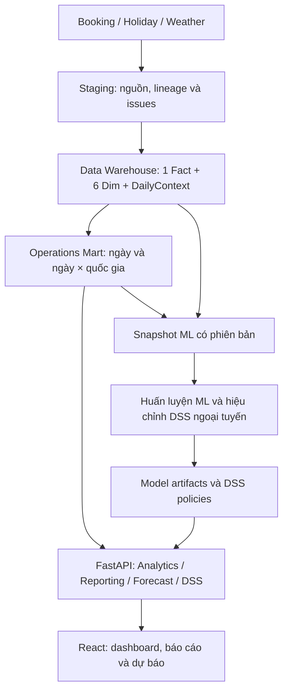

# Hotel Operations Data Warehouse and Decision Support System

Hệ thống kho dữ liệu và hỗ trợ ra quyết định cho vận hành **City Hotel** tại Lisbon, Bồ Đào Nha. Dự án tích hợp dữ liệu Booking, Holiday và Weather qua Staging, Data Warehouse và **Operations Mart**, phục vụ phân tích, báo cáo và dự báo lượng khách theo ngày đến.

## Chức năng

- Phân tích OLAP theo thời gian, quốc gia, ngày lễ và thời tiết.
- Báo cáo KPI về đặt phòng, hủy, lượng khách và số đêm lưu trú của nhóm đặt phòng theo ngày đến.
- Dự báo lượng khách trong 7 ngày tiếp theo.
- Cung cấp nhận xét nhu cầu và phân bổ tương đối ngân sách nguồn lực theo ngày.

## Công nghệ

React + Vite · FastAPI · PostgreSQL 17 · Python ETL/ML · Docker Compose.

## Kiến trúc tổng thể




## Cấu trúc thư mục

```text
.
├── backend/app/           # FastAPI, truy vấn dữ liệu và dịch vụ DSS
├── frontend/src/          # React: Analytics, Reporting và DSS
├── database/              # DDL Staging/DW/Mart, SQL OLAP và validation
├── pipeline/              # ETL Pipeline
│   ├── ingestion/         # Thu thập dữ liệu nguồn
│   ├── source_to_staging/ # Nạp và kiểm tra nguồn
│   ├── staging_to_dw/     # Biến đổi, nạp và publish DW
│   ├── dw_to_mart/        # Tổng hợp Operations Mart
│   └── quality/           # Quality checks và reconciliation
├── ml/demand_forecast/    # Chuẩn bị dữ liệu, train, đánh giá và inference
├── notebooks/             # EDA và thực nghiệm dự báo
├── data/                  # Nguồn đã chọn và metadata thu thập
├── scripts/               # CLI khởi động, điều phối và kiểm chứng
├── tests/                 # Unit và integration tests trên PostgreSQL
├── docs/                  # Thiết kế, runbook và báo cáo kỹ thuật
├── artifacts/             # Evidence, snapshot và model artifacts theo lần chạy
├── infra/                 # Cấu hình hạ tầng và frontend proxy
└── docker-compose.yml     # PostgreSQL, pipeline tools, backend và frontend
```

## Hướng dẫn chạy

### Chạy toàn bộ hệ thống

Cần **Python 3.12+** và **Docker Desktop/Engine với Compose v2** đang chạy. Từ thư mục gốc repository:

```powershell
python scripts/start_app.py
```

Lệnh tự chuẩn bị dữ liệu, model và DSS policies, rồi khởi động các dịch vụ trong Docker. Lần đầu có thể mất vài phút.

Sau khi xuất hiện `Ready`, truy cập các địa chỉ mặc định:

- App: [localhost:5173](http://localhost:5173/dss/demand-forecast)
- API: [localhost:8000/docs](http://localhost:8000/docs)

Chi tiết cấu hình, log và xử lý lỗi: [App runbook](docs/app_runbook.md).

### Chạy và kiểm tra từng bước

Chuẩn bị `.venv` và PostgreSQL theo [hướng dẫn môi trường](docs/dw_runbook.md#1-cài-và-kích-hoạt-môi-trường), sau đó thực hiện lần lượt:

1. Nạp và kiểm tra nguồn: [Staging runbook](docs/staging_runbook.md).
2. Xây kho dữ liệu và Mart: [DW/Mart runbook](docs/dw_runbook.md).
3. Train và phục vụ model: [ML serving handoff](docs/ml/ml_serving_handoff.md#commands-and-verification).
4. Hiệu chỉnh DSS: [nhận xét nhu cầu](docs/dss_v2_sensitivity.md), [phân bổ nguồn lực](docs/dss_resource_allocation.md#reproduce-and-verify).
5. Khởi động và kiểm tra ứng dụng: [App runbook](docs/app_runbook.md).

## Tài liệu hiện hành

| Tài liệu | Nội dung |
|---|---|
| [Detailed plan](docs/detailed_plan.md) | Phạm vi, kiến trúc, yêu cầu nghiệp vụ và tiến độ |
| [Staging report](docs/member2_execution_plan.md) | Trạng thái gate, số liệu đối soát và bàn giao |
| [Staging runbook](docs/staging_runbook.md) | Lệnh nạp ba nguồn, kiểm tra PostgreSQL và rerun |
| [DW/Mart design](docs/dw_design/dw_design.md) | 1 FactBooking + 6 Dim + 1 DailyContext; đầu ra Operations Mart; attributes, mapping, kế hoạch code và nghiệm thu |
| [DW/Mart runbook](docs/dw_runbook.md) | Staging → DW đã chạy local: snapshot, loader, quality, rerun và evidence DW READY |
| [DW/Mart report](docs/dw_report.md) | Quá trình triển khai, danh mục file, quy tắc dữ liệu và kết quả nghiệm thu |
| [App runbook](docs/app_runbook.md) | Khởi động hệ thống bằng Docker, cấu hình và xử lý lỗi |
| [Notebook experiments](notebooks/README.md) | EDA, thực nghiệm dự báo, kết quả và cách chạy notebook |
| [ML serving handoff](docs/ml/ml_serving_handoff.md) | Model artifacts, snapshot, inference và API dự báo |
| [DSS design](docs/dss_v2_design.md) | Thiết kế bộ máy diễn giải nhu cầu và baseline DSS |
| [DSS sensitivity report](docs/dss_v2_sensitivity.md) | Quy tắc nhận xét hiện hành, hiệu chỉnh ngưỡng và kết quả đánh giá |
| [DSS resource allocation](docs/dss_resource_allocation.md) | Policy phân bổ nguồn lực, cách kiểm chứng và giới hạn sử dụng |
| [Master plan](docs/Hotel_booking_Overall_plan.md) |Tài liệu tham khảo về kiến trúc, định hướng mở rộng; phạm vi triển khai theo các tài liệu hiện hành ở trên.|
