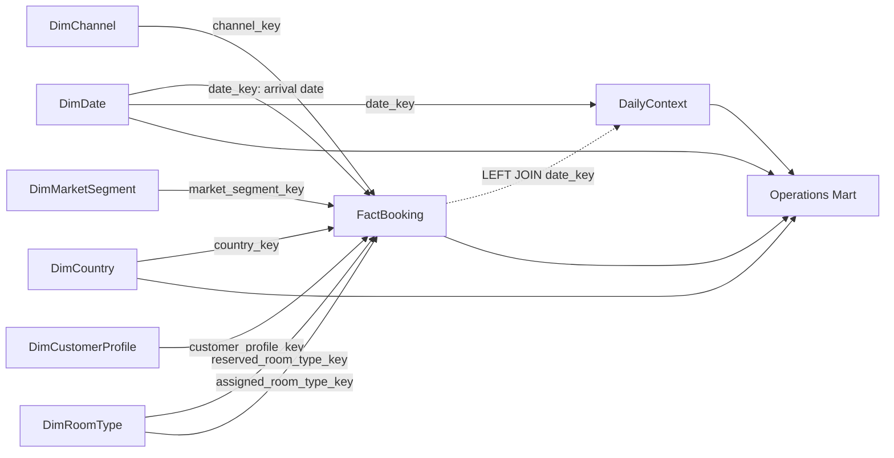

# Thiết kế DW thống nhất — 1 Fact, 6 Dim, 1 DailyContext

**Ngày chốt cấu trúc/phạm vi:** 24/10/2026. **Document ID:** `dw-operations-6dim-design-v1`.

Đây là bản thiết kế hợp nhất hiện hành, quy định mô hình, baseline dữ liệu và tiêu chí nghiệm thu. Grain là mức chi tiết mà một dòng đại diện. Trạng thái triển khai được xác định bằng code và evidence trong [báo cáo DW](../dw_report.md#results), không suy từ việc tài liệu thiết kế đã được chấp nhận.

**Trạng thái triển khai 26/10/2026:** **DW READY trên local**, đã nạp đủ 1 Fact + 6 Dim + DailyContext, quality/rerun/tests đạt. Operations Mart chưa triển khai. [Runbook và evidence DW](../dw_runbook.md) là căn cứ nghiệm thu; các baseline ngày 26/10 bên dưới giữ lịch sử quyết định dữ liệu.

## 1. Phạm vi và trạng thái quyết định

| Nội dung | Quyết định |
|---|---|
| Khách sạn | Chỉ City Hotel; không DimHotel và không hotel_key |
| DW nghiệp vụ | **1 FactBooking + 6 Dim + 1 DailyContext** |
| Sáu dimension | DimDate, DimCountry, DimChannel, DimMarketSegment, DimCustomerProfile, DimRoomType |
| Grain fact | Một reservation record nguồn được nhận vào fact; không phải một người/phòng/ngày lưu trú |
| Ngày phân tích | Arrival date; `date_key` trong fact là khóa ngày đến |
| DailyContext | Tên logic; tên bảng vật lý giữ `dw.daily_hotel_context`, một dòng/ngày của City Hotel |
| Đầu ra Mart theo thiết kế | Chỉ **Operations Mart**, gồm tổng ngày và breakdown country; chưa triển khai |
| Định hướng forecast ở giai đoạn sau | Proxy lượng khách không hủy theo ngày đến, 7 ngày sau cutoff dữ liệu |
| Ngoài phạm vi đầu ra | Customer, Revenue & Cancellation, Booking/Commercial Mart và mô hình tương ứng |
| Không bổ sung | DimDepositType, DimMeal, DimAgent, DimCompany, DimPartyType |

**Phạm vi đã thống nhất:** cấu trúc 1/6/1, City Hotel, arrival date và đầu ra Operations. Áp dụng D01–D08 tại [mục 12](#decisions-baseline), gồm bổ sung D05 về giả định Booking completeness. D01 giữ lineage và validation dù cả 4 dòng thiếu children của source hiện hành đều đã hủy. D02 giữ booking kèm warning và guest-ineligible. Mapping, coverage evidence, migration và loader DW đã được triển khai/kiểm chứng; **DW READY trên local**, Mart chưa triển khai. API/ML contract được liên kết ở giai đoạn sau; ngưỡng model, split hoặc feature window của mẫu ML không chặn nghiệm thu DW/Mart.

Bốn chiều Channel/Segment/Profile/Room **được xây và nạp ngay trong DW** dù chưa dùng trong Operations Mart. Không chờ Customer Mart mới triển khai; cũng không tạo Customer views/API/forecast ở giai đoạn này.

Các bảng run, coverage, issue, rejection, quality và migration ledger là bảng kỹ thuật, không tính thêm vào 6 Dim hoặc 1 DailyContext nghiệp vụ.

## 2. Kiến trúc và quan hệ

```text
Booking City Hotel + Holiday PT/Lisboa + Weather ERA5 Lisbon
                           ↓
                Staging published snapshot
                           ↓
           DW: 1 Fact + 6 Dim + DailyContext
                           ↓
        Operations Mart: ngày / ngày × country
                           ↓
            Analytics / Reporting / Features → Mining-DSS
```



DimRoomType dùng hai vai trò nhưng chỉ là một bảng. Quan hệ fact→context nét đứt là phép join theo ngày; không phải thêm một dimension hoặc một context key trong fact. Context có PK/FK date_key đến DimDate. Operations không phải join Channel/Segment/Profile/Room khi không dùng các trục này.

## 3. Quy ước kỹ thuật và đầu vào

- Tên vật lý snake_case, schema `staging`, `dw`, `mart` cùng PostgreSQL database. Không bắt buộc tạo database riêng cho mỗi lớp.
- N=NOT NULL, Y=nullable trong các bảng dưới. Timestamp kỹ thuật là TIMESTAMPTZ; ngày nghiệp vụ giữ lịch ngày nguồn, timezone context `Europe/Lisbon`.
- Khóa nguồn Staging là `(_source_file_sha256,_source_row_id)`; CSV header=1, record đầu=2, giữ ordinal **trước lọc City Hotel**. Không dùng checksum thuộc tính để xóa reservation trông giống nhau.
- Target đổi tên metadata thành `(source_file_sha256,source_row_id)`, UNIQUE trên fact. Row `_batch_id` là lần đầu nạp vật lý, có thể khác active Staging batch.
- DW đọc `v_booking_current`, `v_holiday_current`, `v_weather_current`, registry/quality_issue của **cùng published snapshot**. `v_daily_context_current` dùng để đối chiếu; không tự chứng nhận mọi typed value đã hợp lệ cho DW.
- Tên registry thật là `staging.load_batch`, `load_batch_source`, `active_snapshot`. Không dùng `load_batches` hoặc `_source_sha256` của bản nháp cũ.
- Baseline fact/dim/context phục vụ một snapshot hiện hành; full refresh nguồn mới thay snapshot cũ, không cộng dồn các file khác checksum. Run/issue/rejection/coverage giữ lịch sử kỹ thuật.
- Surrogate keys không phải định danh nguồn bền vững. Full rebuild có thể cấp key mới; đối chiếu A/B/lần chạy bằng source key hoặc natural code, không bằng booking_key.
- Không SCD2 cho baseline này. DimCustomerProfile mô tả tổ hợp thuộc tính, không mô tả lịch sử một người.

### Grain và keys tổng hợp

| Bảng DW | Grain | Khóa |
|---|---|---|
| dim_date | Một ngày lịch | PK date_key, UNIQUE full_date |
| dim_country | Một country code chuẩn hóa | PK country_key, UNIQUE country_code |
| dim_channel | Một channel code chuẩn hóa | PK channel_key, UNIQUE channel_code |
| dim_market_segment | Một segment code chuẩn hóa | PK market_segment_key, UNIQUE market_segment_code |
| dim_customer_profile | Một tổ hợp customer type × repeat status | PK customer_profile_key, UNIQUE (customer_type_code,repeat_status) |
| dim_room_type | Một room type code chuẩn hóa | PK room_type_key, UNIQUE room_type_code |
| fact_booking | Một reservation nguồn được nhận | PK booking_key, UNIQUE (source_file_sha256,source_row_id) |
| daily_hotel_context | Một ngày của City Hotel | PK/FK date_key |

## 4. Attributes của sáu dimension

Dimension chứa các thuộc tính mô tả phục vụ lọc, nhóm và tổng hợp dữ liệu. **Thuộc tính của dimension không bắt buộc phải xuất hiện sẵn trong Booking**: có thể lấy trực tiếp từ Staging, dẫn xuất theo quy tắc xác định hoặc bổ sung từ dictionary/mapping đã xác nhận. Mỗi thuộc tính phải phù hợp với grain của dimension và có ý nghĩa, nguồn hoặc công thức rõ ràng.

Ví dụ, từ `full_date` có thể tính `year`, `quarter`, `month`, `iso_year`, `iso_week`, `day_of_week` và `is_weekend`. DimDate vẫn lưu các giá trị này để báo cáo/BI dùng trực tiếp các cấp thời gian, thống nhất cách tính giữa các đầu ra và giảm tính toán lặp khi truy vấn. Đây là sự dư thừa có chủ đích của mô hình chiều; lợi ích không chỉ nằm ở tốc độ mà còn ở tính dễ sử dụng và nhất quán. Hiệu quả tốc độ thực tế cần được đánh giá theo truy vấn, không mặc định mọi cột dẫn xuất đều làm hệ thống nhanh hơn.

Tiêu chí giữ thuộc tính là nhu cầu phân tích, quy tắc ổn định và khả năng xác định đáng tin cậy. Các cấp năm/quý/tháng, tuần ISO và weekday/weekend phục vụ trực tiếp Operations; `day_name`/`month_name` là nhãn hiển thị theo config. `country_name` cần mapping từ `country_code`, không phải phép tính từ mã. Không suy thêm hạng phòng, sức chứa hoặc đặc điểm khách hàng khi nguồn chưa cung cấp căn cứ.

Các giả thuyết và biến đổi riêng cho Mining như lag/rolling, ngưỡng nhu cầu hoặc cửa sổ ảnh hưởng ngày lễ được quản lý ở lớp feature theo mục 9.5. Danh sách attributes dưới đây giữ các mô tả đã chọn cho DW; việc lưu nhiều thuộc tính mô tả không làm thay đổi grain của từng dimension.

### 4.1. `dw.dim_date`

| Attribute | Kiểu/null | Ý nghĩa/nguồn |
|---|---|---|
| date_key | INTEGER N | PK, YYYYMMDD tính từ full_date |
| full_date | DATE N | UNIQUE, ngày lịch |
| year | SMALLINT N | Năm lịch |
| quarter | SMALLINT N | 1…4 |
| month | SMALLINT N | 1…12 |
| day_of_month | SMALLINT N | Ngày trong tháng, khớp full_date |
| iso_year | SMALLINT N | Năm của tuần ISO |
| iso_week | SMALLINT N | 1…53, tính từ full_date |
| day_of_week | SMALLINT N | ISO: 1=Thứ Hai…7=Chủ Nhật |
| day_name | TEXT N | Nhãn thứ theo config thống nhất |
| month_name | TEXT N | Nhãn tháng; sắp xếp bằng month |
| is_weekend | BOOLEAN N | day_of_week IN (6,7) |

Sinh lịch liên tục theo `calendar.start`/`calendar.end`, bao phủ actual và ít nhất 7 ngày sau `data_coverage_end`. Đây là tên field trong config hiện hành. Không chỉ lấy DISTINCT ngày có booking; không sao chép source week thành ISO week. **is_holiday thuộc DailyContext**, không lưu lặp ở đây.

Calendar phải chứa mọi arrival date hợp lệ của snapshot được chọn. Nếu cấu hình range thiếu ngày hợp lệ thì fail cấu hình/build, không tự đổi Booking đó thành rejected hoặc dùng unknown date key.

### 4.2. `dw.dim_country`

| Attribute | Kiểu/null | Ý nghĩa/nguồn |
|---|---|---|
| country_key | INTEGER IDENTITY N | PK; explicit unknown key=0 |
| country_code | TEXT N | UNIQUE, mã chuẩn theo mapping; unknown=`UNK` |
| country_name | TEXT N | Tên theo mapping, unknown=`Unknown` |
| is_unknown | BOOLEAN N | true đúng ở key=0 |

Nguồn `Booking.country`: giữ token gốc, trim/uppercase và map theo dictionary versioned. Thiếu/không map → UNK + issue theo D03 đã tạm chốt. Country là thông tin của reservation, không suy quốc tịch từng người trong party.

### 4.3. `dw.dim_channel`

| Attribute | Kiểu/null | Ý nghĩa/nguồn |
|---|---|---|
| channel_key | INTEGER IDENTITY N | PK; unknown key=0 |
| channel_code | TEXT N | UNIQUE, code chuẩn từ distribution_channel |
| channel_name | TEXT N | Nhãn theo mapping, có thể dùng code nếu chưa có tên đã xác nhận |
| is_unknown | BOOLEAN N | true đúng ở key=0 |

Unknown code=`UNKNOWN`. Không tự gán một mã chưa rõ vào nhóm Other có ý nghĩa khác. Dù Operations không dùng channel, ETL vẫn phải map và kiểm tra chiều này.

### 4.4. `dw.dim_market_segment`

| Attribute | Kiểu/null | Ý nghĩa/nguồn |
|---|---|---|
| market_segment_key | INTEGER IDENTITY N | PK; unknown key=0 |
| market_segment_code | TEXT N | UNIQUE, code chuẩn từ market_segment |
| market_segment_name | TEXT N | Nhãn từ mapping/dictionary |
| is_unknown | BOOLEAN N | true đúng ở key=0 |

Unknown code=`UNKNOWN`. Channel và segment là hai trục độc lập cùng tham chiếu trực tiếp từ fact; không giả định một segment luôn thuộc duy nhất một channel.

### 4.5. `dw.dim_customer_profile`

| Attribute | Kiểu/null | Ý nghĩa/nguồn |
|---|---|---|
| customer_profile_key | INTEGER IDENTITY N | PK, full-unknown key=0 |
| customer_type_code | TEXT N | Từ customer_type đã mapping; UNKNOWN khi chưa rõ |
| customer_type_name | TEXT N | Nhãn loại khách theo mapping |
| repeat_status | TEXT N | NEW / REPEAT / UNKNOWN |
| is_repeated_guest | BOOLEAN Y | false/true/NULL khớp repeat_status |
| is_unknown | BOOLEAN N | true chỉ ở profile (UNKNOWN,UNKNOWN) key=0 |

UNIQUE `(customer_type_code,repeat_status)`, cả hai NOT NULL. 0/1 ở Staging repeated flag → NEW/REPEAT; missing/invalid → UNKNOWN + issue. Giữ các tổ hợp thông tin một phần như (UNKNOWN,REPEAT) hoặc (type đã biết,UNKNOWN), không làm mất phần đã biết.

Đây **không phải DimCustomer từng người**. Không dùng profile_key để đếm khách hàng duy nhất, lifetime value hoặc lịch sử cá nhân; nguồn chưa có stable customer ID.

### 4.6. `dw.dim_room_type`

| Attribute | Kiểu/null | Ý nghĩa/nguồn |
|---|---|---|
| room_type_key | INTEGER IDENTITY N | PK; unknown key=0 |
| room_type_code | TEXT N | UNIQUE, hợp normalized codes của reserved/assigned |
| room_type_name | TEXT Y | Chỉ điền khi có dictionary xác nhận ý nghĩa code |
| is_unknown | BOOLEAN N | true đúng ở key=0 |

Unknown code=`UNKNOWN`. Hai vai trò reserved/assigned cùng dùng bảng này sau khi xác minh code chung namespace. Không tự đoán code A/B là hạng phòng, sức chứa, loại giường hoặc số phòng vật lý.

Các dimension phân loại tạo từ codes/tổ hợp của **candidate fact được nhận**, cộng row unknown; không đưa mọi mã của thế giới hoặc các record bị loại core vào Dim. Dựng lại dimensions và FK đồng bộ khi full refresh, không hứa surrogate key ổn định qua rebuild.

## 5. Attributes của `dw.fact_booking`

Đầy đủ **31 attributes**, gồm 7 FK nghiệp vụ: Date, Country, Channel, Segment, Profile và hai vai trò RoomType.

| Attribute | Kiểu/null | Ý nghĩa/nguồn |
|---|---|---|
| booking_key | BIGINT IDENTITY N | PK kỹ thuật |
| source_file_sha256 | CHAR(64) N | Từ `_source_file_sha256`, cùng row ID UNIQUE/FK kép đến Staging Booking |
| source_row_id | BIGINT N | CSV ordinal trước lọc từ `_source_row_id` |
| source_first_batch_id | UUID N | FK staging.load_batch; `_batch_id` của row vật lý |
| dw_run_id | UUID N | FK dw.load_run, lần transform hiện hành |
| date_key | INTEGER N | FK DimDate theo arrival_date |
| country_key | INTEGER N | FK DimCountry, 0 nếu unknown |
| channel_key | INTEGER N | FK DimChannel, 0 nếu unknown |
| market_segment_key | INTEGER N | FK DimMarketSegment, 0 nếu unknown |
| customer_profile_key | INTEGER N | FK DimCustomerProfile |
| reserved_room_type_key | INTEGER N | FK DimRoomType vai trò phòng đặt |
| assigned_room_type_key | INTEGER N | FK cùng DimRoomType vai trò phòng được phân |
| country_raw | TEXT Y | Token gốc từ raw_record.country, giữ cả case/space/token missing |
| booking_count | SMALLINT N | CHECK=1 |
| is_canceled | SMALLINT N | CHECK IN (0,1), giữ cả hủy và không hủy |
| adults | INTEGER Y | Số người lớn hợp lệ không âm |
| children | INTEGER Y | Số trẻ em hợp lệ, không tự đổi missing thành 0 |
| babies | INTEGER Y | Số em bé hợp lệ không âm |
| total_guests | BIGINT Y | Tổng khi đủ ba component; tổng=0 vẫn có thể lưu nhưng guest-ineligible |
| guest_eligible | BOOLEAN N | true khi đủ component nguyên/không âm và total>0, theo D01/D02 |
| stays_in_week_nights | INTEGER Y | Số đêm ngày thường trong kỳ lưu trú |
| stays_in_weekend_nights | INTEGER Y | Số đêm cuối tuần trong kỳ lưu trú |
| total_stay_nights | BIGINT Y | Tổng hai thành phần nights nếu đủ hợp lệ |
| stay_eligible | BOOLEAN N | Đủ nights hợp lệ, tổng>=0 |
| lead_time | INTEGER Y | Số ngày từ lúc đặt đến ngày đến, >=0 |
| adr | NUMERIC Y | Giá trung bình ngày theo nguồn; giữ precision theo D04, không là doanh thu |
| party_type | TEXT N | SINGLE/COUPLE/FAMILY/OTHER_GROUP/UNKNOWN |
| party_eligible | BOOLEAN N | Theo baseline D07 bằng guest_eligible |
| room_changed_flag | BOOLEAN Y | Reserved-vs-assigned mismatch khi biết đủ hai room codes |
| room_comparison_eligible | BOOLEAN N | Hai room codes cùng namespace và đều xác định |
| transformed_at | TIMESTAMPTZ N | Timestamp kỹ thuật |

`room_changed_flag` chỉ là chênh lệch mã đặt/phân, không chứng minh sự kiện chuyển phòng, upgrade hoặc khách không hài lòng. Missing room → comparison false, flag NULL; không coi unknown/unknown là “không đổi”.

Party/profile/room attributes được chuẩn bị trong DW, **không tạo Customer Mart hoặc thêm KPI Customer vào Operations**. Raw của các categorical fields tra từ Staging bằng source key; không cần lặp mọi token vào fact.

### Constraints và indexes

- PK booking_key; UNIQUE `(source_file_sha256,source_row_id)`; FK kép đến `staging.stg_booking(_source_file_sha256,_source_row_id)`.
- FK đúng đủ bảy vai trò nghiệp vụ + run/first-batch. source_first_batch_id phải khớp row nguồn, không chỉ tồn tại trong batch registry.
- Guest/nights INTEGER hợp lệ trong 0…2.147.483.647, không ép phân số bằng rounding/truncation; tổng dùng BIGINT. ADR chỉ nhận numeric hữu hạn >=0, 0 hợp lệ.
- CHECK component/total/eligibility nhất quán: thiếu component → total NULL, false; đủ guest → total đúng phép cộng, guest_eligible=(total>0); đủ nights → tổng đúng, stay_eligible=true. Viết nhánh IS NULL rõ vì CHECK SQL có thể chấp nhận UNKNOWN.
- CHECK party_type/party_eligible khớp rules; repeat status/boolean khớp ở dimension; room flags khớp keys/codes.
- Index nền: fact(date_key), (country_key,date_key), (channel_key,date_key), (market_segment_key,date_key), (customer_profile_key,date_key), (reserved_room_type_key,date_key), (assigned_room_type_key,date_key), (dw_run_id), (source_first_batch_id). Source UNIQUE đã tạo index. Thêm index khác theo query/EXPLAIN thực tế.

## 6. Attributes của DailyContext — `dw.daily_hotel_context`

| Attribute | Kiểu/null | Ý nghĩa/nguồn |
|---|---|---|
| date_key | INTEGER N | PK/FK DimDate, tối đa một context/ngày |
| dw_run_id | UUID N | FK load_run |
| is_holiday | BOOLEAN Y | true=lễ hợp lệ; false=đã chứng nhận non-holiday; NULL=chưa xác định |
| has_national_holiday | BOOLEAN Y | Có lễ toàn quốc Portugal hợp lệ trong ngày; false chỉ khi coverage national được xác nhận đầy đủ; chưa rõ giữ NULL |
| has_lisboa_holiday | BOOLEAN Y | Có lễ riêng Lisboa hợp lệ trong ngày; false chỉ khi coverage Lisboa được xác nhận đầy đủ; chưa rõ giữ NULL |
| holiday_names | TEXT[] N | Tên lễ hợp lệ unique và sắp xếp ổn định, mặc định [] |
| holiday_record_count | INTEGER N | Số holiday rows hợp lệ cùng ngày |
| holiday_data_status | TEXT N | COMPLETE/PARTIAL/MISSING/UNKNOWN |
| holiday_source_sha256 | CHAR(64) N | File Holiday được chọn của run |
| temperature_mean | NUMERIC Y | °C, từ temperature_2m_mean của entry duy nhất hợp lệ |
| precipitation | NUMERIC Y | mm/ngày >=0, missing không thành 0 |
| temperature_status | TEXT N | COMPLETE/MISSING/INVALID/AMBIGUOUS/UNKNOWN |
| precipitation_status | TEXT N | Chất lượng riêng cho mưa, cùng tập trạng thái |
| weather_record_count | INTEGER N | Số entries của nguồn được chọn có local_date này |
| weather_ambiguous | BOOLEAN N | Có nhiều entry gây mơ hồ |
| weather_source_sha256 | CHAR(64) N | File Weather được chọn của run |
| transformed_at | TIMESTAMPTZ N | Thời điểm transform |

Tên City Hotel, Lisbon, timezone Europe/Lisbon, ERA5, tọa độ request/grid và units lưu trong config/source metadata của run. Hiện chỉ có temperature và precipitation; không tạo humidity/wind giả.

Sinh đủ context cho calendar phục vụ; ngoài source coverage, values chưa biết giữ NULL. Gộp nhiều lễ trước join; Weather duplicate không lấy min/max để chọn tùy tiện. Validate typed values cùng issues: Staging có thể giữ số âm hoặc flag invalid đọc được.

Holiday false chỉ khi calendar đúng PT/Lisboa được xác nhận đầy đủ cho ngày. Invalid date không biết ngày ảnh hưởng có thể làm khoảng calendar chưa đủ căn cứ non-holiday; ghi coverage/issue thay vì âm thầm bỏ record. is_weekend vẫn nằm ở DimDate.

**Bổ sung ngày 26/10/2026 — giữ phân biệt national/Lisboa phục vụ EDA:** hai cờ scope là thông tin lịch nghiệp vụ từ nguồn, được giữ trong DailyContext để Mining có thể so sánh các nhóm ngày. Một ngày có thể đồng thời có lễ national và lễ Lisboa, vì vậy dùng hai cờ độc lập trên cùng dòng ngày.

- `has_national_holiday=true` khi tồn tại holiday row hợp lệ có `country=PT`, `scope=national`. `subdivision=NULL` ở dòng national là hợp lệ, không phải lý do loại lễ.
- `has_lisboa_holiday=true` khi tồn tại holiday row hợp lệ có `country=PT`, `scope=Lisboa`, `subdivision=11`. Cả hai nhóm vẫn phải đạt các kiểm tra date/name/category/observed theo contract nguồn.
- Mỗi cờ chỉ là false khi có evidence lịch đầy đủ cho đúng ngày và scope, không có lễ hợp lệ và không còn lỗi có thể che khuất lễ của scope đó; còn lại giữ NULL. Config/evidence coverage phải xác định phạm vi national và Lisboa được chứng nhận. Chỉ có coverage national chưa đủ kết luận cờ Lisboa=false.
- `is_holiday = has_national_holiday OR has_lisboa_holiday` theo logic ba giá trị SQL: một cờ true thì kết quả true; cả hai false thì false; không có true và còn NULL thì NULL. `holiday_names` vẫn là hợp tên hợp lệ của hai scope, không nhân dòng context; `holiday_record_count` vẫn đếm các source rows hợp lệ. `holiday_data_status` mô tả độ đầy đủ của toàn lịch áp dụng cho Lisbon; một cờ true không tự làm trạng thái COMPLETE khi scope còn lại chưa được xác nhận.

Ví dụ logic minh họa, không phải kết quả profiling nguồn:

| National | Lisboa | is_holiday | Diễn giải |
|---|---|---|---|
| true | false | true | Có lễ national; đã xác nhận không có lễ riêng Lisboa |
| false | true | true | Có lễ riêng Lisboa; đã xác nhận không có lễ national |
| true | true | true | Có cả hai loại lễ trong ngày |
| false | false | false | Đã xác nhận ngày không có lễ ở cả hai scope |
| true | NULL | true | Đã biết có lễ national; thông tin lễ riêng Lisboa chưa rõ |
| false | NULL | NULL | Chưa thể kết luận ngày thường vì scope Lisboa chưa rõ |

EDA có thể dựng nhóm NATIONAL_ONLY/LISBOA_ONLY/BOTH/NONE khi cả hai cờ đã biết; các trường hợp còn NULL vào nhóm UNKNOWN, không tự gán sang nhóm chỉ có một loại lễ. Nhóm này là projection phục vụ phân tích, chưa cần thêm cột lưu trong DW. Tên lễ gắn với từng scope có thể tra lại Staging theo file checksum, ngày và scope. Việc giữ scope cho phép kiểm tra giả thuyết tác động tới demand; chưa khẳng định có tác động hoặc bắt buộc dùng các cờ này trong model.

Context là dữ liệu **theo ngày**, không phải measure cộng được theo booking. Không SUM lượng mưa trên fact đã join context; aggregate fact về ngày trước hoặc đọc context riêng.

## 7. Rules transform và chất lượng — baseline D01–D08

Các rules mục này đã được áp dụng trong DW. Version được ghi qua contract/rule/config, mapping và build fingerprint; giữ [ghi chú tác động trên dataset thật tại mục 12](#decisions-baseline) khi bàn giao downstream.

| Tình huống | Xử lý theo baseline |
|---|---|
| Ngày đến thiếu/sai | Không vào fact chính; một booking_rejection/source row + issues. Không đoán ngày; unknown-date ảnh hưởng coverage chưa xác định thì block publish |
| Cancellation missing/ngoài 0,1 | Không vào fact; nếu biết ngày, ngày đó thiếu booking/cancellation và guest completeness |
| Guest component thiếu/invalid/âm/phân số/overflow | Giữ fact nếu core hợp lệ; component sai→NULL, total_guests=NULL, guest_eligible=false + issue |
| Guest tổng=0 | Giữ booking, total=0, guest_eligible=false, warning ZERO_GUESTS |
| Nights thiếu/sai | Giữ booking; total_stay_nights=NULL, stay_eligible=false |
| Nights=0 | Giữ 0, eligible nếu đủ component, warning để đối soát |
| Lead time/ADR thiếu/sai/âm | NULL + issue; chỉ loại khỏi measure/mẫu số tương ứng; ADR=0 hợp lệ |
| Country/channel/segment/room code chưa rõ | Unknown dimension + issue, không xóa booking |
| Profile biết một phần | Giữ tổ hợp phần biết/phần UNKNOWN, không gom mất thông tin |
| Context thiếu/invalid | Giữ booking, LEFT JOIN, values NULL + status |

Không dùng COALESCE(children,0), missing precipitation=0, missing holiday=false hoặc global dropna. Missing và invalid đều có thể dẫn tới typed NULL nhưng issue/reason phải phân biệt và raw còn truy vết được.

**Ghi chú source set hiện tại:** 4 dòng thiếu children (40602, 40669, 40681, 41162) đều `is_canceled=1`, nên riêng lỗi này không làm thiếu target khách không hủy; giữ booking/issue, không ưu tiên thêm imputation hoặc loại row. Trong 167 ZERO_GUESTS có 144 booking không hủy thuộc 114 ngày: giữ booking và warning, `guest_eligible=false`; chất lượng guest phải phản ánh ảnh hưởng này, không báo COMPLETE chỉ vì không có rejection. Giả thuyết nhân viên chưa hỏi hoặc thiếu sót trao đổi chưa được dữ liệu xác nhận, không dùng để sửa số khách nguồn.

### Dẫn xuất party type

```text
guest_eligible=false → UNKNOWN
children>0 hoặc babies>0 → FAMILY
adults=1, children=0, babies=0 → SINGLE
adults=2, children=0, babies=0 → COUPLE
còn lại trong tập guest hợp lệ → OTHER_GROUP
```

Theo baseline D07, thiếu bất kỳ component nào vẫn UNKNOWN. Các nhãn mô tả thành phần nhóm, không khẳng định quan hệ cá nhân; COUPLE chỉ là hai adults không có children/babies theo nguồn. Giữ classification cả booking hủy nếu đủ dữ liệu, nhưng Operations guest chỉ cộng booking không hủy.

### Coverage theo measure

- Nguồn booking/holiday/weather có coverage evidence riêng theo ngày. Min/max hoặc 793 Weather entries không chứng minh Booking đầy đủ mọi ngày.
- COMPLETE: đã chứng nhận đầy đủ và không có lỗi ảnh hưởng measure. PARTIAL: có phần dữ liệu đáng tin nhưng thiếu row/measure. MISSING: nguồn xác nhận thiếu dữ liệu. UNKNOWN: chưa đủ căn cứ kết luận coverage.
- Non-canceled booking guest-ineligible làm guest ngày đó PARTIAL; canceled booking thiếu guest không tự làm guest target PARTIAL.
- Invalid cancellation/rejected row có ngày biết được làm guest PARTIAL vì chưa biết có nên cộng row đó vào khách không hủy.
- Ngày không Booking chỉ có guest=0 khi source coverage ngày đó COMPLETE. Ngoài coverage/chưa xác nhận không tự lấp 0.
- Channel/profile/room unknown không làm mất guest hợp lệ hoặc chặn Operations chỉ vì các chiều đó chưa được dùng. Tuy nhiên lookup/unknown mapping và vấn đề của cả 6 Dim vẫn phải được kiểm tra, không seed toàn bộ key=0 rồi coi đã nạp xong.

**Quyết định bổ sung 27/10/2026 — D05:** người dùng chấp nhận giả định file Booking đã chọn chứa đầy đủ các reservation City Hotel có ngày đến 01/07/2015–31/08/2017 trong phạm vi dự án. Source Booking coverage trong khoảng này là COMPLETE theo giả định được chấp nhận, không suy từ count/min/max hoặc quality Staging. Quyết định chỉ áp dụng checksum Booking `7c2ae42a7353905ea136e5c2287f17c92c5435826598bfbb8491c6f0c7b1fc06`; ngoài khoảng/đổi source phải đánh giá lại. D01/D02 và eligibility theo measure vẫn giữ nguyên: 114 ngày bị non-canceled ZERO_GUESTS vẫn guest PARTIAL, target=NULL. Xem [decision có version](../../artifacts/dw/operations/booking_coverage_accepted_20261027/decision.json) và [coverage/calendar hiện hành](../dw_report.md#coverage-calendar).

## 8. Bảng kỹ thuật và attributes

Những bảng này hỗ trợ lineage, đối soát và transaction; không tăng số Dim/Context nghiệp vụ. Dưới đây là dictionary gọn; PK/FK ghi rõ, mọi count >=0.

| Bảng / grain | Attributes và kiểu |
|---|---|
| **dw.schema_migration** — một version migration | `version TEXT PK`, `file_sha256 CHAR(64) N`, `applied_at TIMESTAMPTZ N` |
| **dw.load_run** — một attempt DW | `run_id UUID PK`, `data_version UUID UNIQUE N`, `staging_batch_id UUID FK N`, `source_set_fingerprint CHAR(64) N`, `build_fingerprint CHAR(64) N`, `contract_version TEXT N`, `code_version TEXT N`, `mapping_versions JSONB N`, `config_sha256 CHAR(64) N`, `status TEXT N` (loading/published/failed), `started_at TIMESTAMPTZ N`, `finished_at TIMESTAMPTZ Y`, `row_counts JSONB N`, `error_summary TEXT Y` |
| **dw.active_dataset** — một snapshot phục vụ | `singleton_id SMALLINT PK CHECK=1`, `run_id UUID UNIQUE FK N`, `published_at TIMESTAMPTZ N`; run phải published khi publish |
| **dw.source_coverage** — một source/ngày/run | PK `(run_id,source_id,local_date)`; `run_id UUID FK N`, `source_id TEXT N`, `local_date DATE N`, `coverage_status TEXT N`, `evidence_ref TEXT Y`, `evidence_sha256 CHAR(64) Y`, `reason TEXT Y` |
| **dw.row_issue** — một vấn đề/field/row/ngày | `issue_id BIGINT IDENTITY PK`, `run_id UUID FK N`, `source_id TEXT N`, `source_file_sha256 CHAR(64) Y`, `source_row_id BIGINT Y`, `local_date DATE Y`, `field_name TEXT N`, `rule_code TEXT N`, `issue_type TEXT N`, `severity TEXT N`, `disposition TEXT N`, `raw_value JSONB Y`, `reason TEXT N`, `created_at TIMESTAMPTZ N` |
| **dw.booking_rejection** — một Booking không vào fact/run | PK `(run_id,source_file_sha256,source_row_id)`; `run_id UUID FK N`, `source_file_sha256 CHAR(64) N`, `source_row_id BIGINT N` cùng FK kép về Staging Booking; `arrival_date DATE Y`, `reason_codes TEXT[] N` không rỗng, `created_at TIMESTAMPTZ N` |

`source_id` trong coverage là booking/holiday/weather; issue còn có derived. Issue types: missing/invalid/mapping/coverage/warning; severity info/warning/error; disposition REJECT_FACT/NULL_MEASURE/UNKNOWN_DIMENSION/WARN_ONLY/BLOCK_PUBLISH. Không có FK riêng đến Staging Booking cho issue nhiều nguồn; acceptance kiểm tra lineage theo source_id. Một Booking nhiều issue vẫn chỉ một rejection row.

### `dw.daily_data_quality` — một ngày của snapshot hiện hành

| Attribute | Kiểu/null | Ý nghĩa |
|---|---|---|
| date_key | INTEGER N | PK/FK DimDate |
| dw_run_id | UUID N | FK load_run |
| source_booking_count | BIGINT N | Source rows xác định thuộc ngày này |
| fact_booking_count | BIGINT N | Fact rows ngày này |
| rejected_booking_count | BIGINT N | Distinct rejected source rows có ngày biết được |
| non_canceled_booking_count | BIGINT N | Fact không hủy |
| guest_ineligible_booking_count | BIGINT N | Fact không hủy thiếu điều kiện guest |
| stay_ineligible_booking_count | BIGINT N | Fact không hủy thiếu điều kiện nights |
| lead_time_unknown_booking_count | BIGINT N | Fact không hủy lead_time NULL |
| adr_unknown_booking_count | BIGINT N | Fact không hủy ADR NULL |
| unknown_party_booking_count | BIGINT N | Fact không hủy party UNKNOWN |
| unknown_channel_booking_count | BIGINT N | Fact không hủy channel key=0 |
| unknown_segment_booking_count | BIGINT N | Fact không hủy segment key=0 |
| unknown_customer_type_booking_count | BIGINT N | Fact không hủy type UNKNOWN |
| unknown_repeat_booking_count | BIGINT N | Fact không hủy repeat UNKNOWN |
| room_ineligible_booking_count | BIGINT N | Fact không hủy room comparison false |
| booking_data_status | TEXT N | COMPLETE/PARTIAL/MISSING/UNKNOWN |
| guest_data_status | TEXT N | Trạng thái target guest theo coverage/rejection/eligibility |
| stay_data_status | TEXT N | Tương tự cho nights |
| reason_codes | TEXT[] N | Mặc định [] |

Các số đếm kỹ thuật đã quan sát vẫn có thể là 0 khi coverage UNKNOWN; không được dùng chúng để khẳng định KPI thực tế=0. Row unknown-date ở rejection/run issues không gán vào ngày giả. Không tạo customer_mix_data_status hoặc Customer aggregates trong phạm vi hiện tại.

## 9. Đầu ra duy nhất: Operations Mart

### 9.1. `mart.daily_hotel_operations`

Grain **một ngày đến**, UNIQUE date_key, có đủ calendar của khoảng dữ liệu phục vụ đã chọn. Không cần materialize các ngày future horizon như actual; DimDate/DailyContext có thể bao phủ rộng hơn.

| Nhóm | Attributes đầu ra |
|---|---|
| Ngày/phiên bản | date_key, full_date, year, quarter, month, iso_year, iso_week, day_of_week, is_weekend, data_version |
| Context | is_holiday, has_national_holiday, has_lisboa_holiday, holiday_names, temperature_mean, precipitation, holiday_data_status, temperature_status, precipitation_status |
| Chất lượng | booking_data_status, guest_data_status, stay_data_status, rejected_booking_count, guest_ineligible_booking_count, stay_ineligible_booking_count |
| Count | total_bookings, non_canceled_bookings, total_cancellations, guest_valid_booking_count, stay_valid_booking_count, lead_time_valid_count, adr_valid_count |
| Sum | observed_total_adults, observed_total_children, observed_total_babies, observed_total_guests, observed_total_stay_nights, sum_lead_time, sum_adr |
| KPI | cancellation_rate, avg_party_size, avg_stay_nights, avg_lead_time, avg_adr |

Counts/sums dùng BIGINT trừ ADR dùng NUMERIC; ratio/averages có thể trả DOUBLE PRECISION hoặc NUMERIC theo API contract được thống nhất. Giá trị không xác định giữ NULL; mẫu số=0 → NULL. API muốn dùng tên `total_guests` có thể alias observed_total_guests nhưng luôn đi cùng status, không tự biến PARTIAL thành actual đầy đủ.

### 9.2. `mart.daily_hotel_operations_by_country`

Grain `(date_key,country_key)`. Thêm country_code/name vào bộ calendar/context/measure tương ứng; aggregate trực tiếp từ fact cùng rules, không join hai aggregate rồi SUM. Giữ country unknown trong đối soát. Chất lượng/rejected của ngày không tự thành sạch khi lọc country; không cộng lại các day-level counters bị lặp qua country.

Operations hiện chỉ dùng **Date + Country + DailyContext**. Không đưa channel/segment/profile/room vào grain hoặc API filter để tránh tự mở phạm vi nghiệp vụ. DW vẫn nạp và validate đủ sáu chiều.

**Chi tiết triển khai:** giữ đủ ngày actual × country của accepted candidate + UNK, rồi LEFT JOIN aggregate fact. Country filter giữ nguyên số ngày lịch. Với ô country rỗng, chỉ trả 0 khi source Booking COMPLETE và ngày không có core rejection; còn lại giữ NULL cho serving measures. Quality/counters cấp ngày tiếp tục đi cùng mỗi country, không được cộng lặp. Xem [country calendar](../dw_report.md#country-calendar) và fixture expected values; SQL Mart chưa triển khai.

### 9.3. Công thức với eligibility từng measure — baseline tạm chốt

Đặt A=all fact trong nhóm lọc, B=A không hủy, G=B guest_eligible, S=B stay_eligible, L=B lead_time hợp lệ, R=B ADR hợp lệ.

| Measure | Công thức |
|---|---|
| total_bookings | count(A) |
| non_canceled_bookings / total_cancellations | count(B); count(A với canceled=1), hai measure riêng |
| cancellation_rate | total_cancellations / total_bookings |
| observed_total_guests | sum(total_guests trên G) |
| observed adults/children/babies | Sum components trên cùng tập G, để ba thành phần cộng khớp tổng khách |
| avg_party_size | sum guest trên G / count(G), không chia count(B) khi còn guest chưa rõ |
| observed_total_stay_nights / avg_stay_nights | Sum nights trên S; average=sum/count(S) |
| avg_lead_time / avg_adr | sum trên L/count(L); sum trên R/count(R) |
| target_guests | Observed guest chỉ khi guest_data_status=COMPLETE, còn lại NULL |

Không có guest hợp lệ nhưng có non-canceled booking guest-ineligible → guest total chưa biết, không trả 0 như đủ dữ liệu. Chỉ trả guest=0 khi Booking source coverage COMPLETE, không có non-canceled booking và không có core rejection của ngày. Nếu có core rejection thì chưa xác định đủ demand, kể cả khi không có fact không hủy. Tổng PARTIAL chỉ mô tả phần đã biết và có warning.

Quy tắc NULL/0 cụ thể theo [báo cáo triển khai](../dw_report.md#null-zero): valid counts/observed technical counts rỗng có thể là 0; serving counts/sums không tự là 0 khi coverage chưa đủ hoặc có core rejection. Known defect ảnh hưởng measure làm status PARTIAL; nếu chưa có defect thì kế thừa coverage nguồn. Calendar/config/mappings/coverage đã có kiểm tra đầu vào, nhưng preflight passed không chứng nhận DW READY hoặc Booking COMPLETE.

Roll-up ngày→tuần/tháng cộng sum/count rồi tính lại tỷ lệ/trung bình; không average các average. Average guests/day chỉ là tổng guest / số ngày lịch khi toàn bộ ngày chọn guest COMPLETE. Country filter không giảm mẫu số ngày. Weather summary lấy mỗi ngày một lần, không trọng số theo số Booking nếu không có định nghĩa riêng.

### 9.4. Feature dataset cho Operations

Phần feature/ML thuộc giai đoạn sau, chưa triển khai và không nằm trong gate DW/Mart hiện tại. Danh sách dưới đây là định hướng để liên kết API/ML contract sau khi Mart có đầu ra thực tế; không phải yêu cầu tạo feature dataset trước khi nghiệm thu DW hoặc Mart.

`mart.demand_features` là output kỹ thuật dự kiến của cùng Operations domain, grain date_key: date_key/full_date, data_version, feature_version, target_guests, lag_1, lag_7, rolling_mean_7/14, day_of_week, month, is_weekend, optional is_holiday đã xác nhận, feature_ready.

Operations Mart giữ hai cờ `has_national_holiday`/`has_lisboa_holiday` để EDA đọc trực tiếp ở grain ngày. Nếu Mining chọn chúng làm feature sau EDA/validation, bổ sung feature specification/version và kiểm tra coverage/availability của từng scope cho train và horizon. Baseline feature hiện tại chưa tự thêm hai cờ vào vector mô hình; các phép tổng hợp demand theo nhóm lễ vẫn dùng cùng sum/count và quality rules.

Lag/rolling chỉ dùng actual COMPLETE trước ngày dự báo; lịch sử không đủ giữ feature_ready=false, không nối bỏ ngày rồi coi chuỗi liên tục. Không dùng observed Weather tương lai. Không xây Customer forecasting trong giai đoạn này.

### 9.5. Phân lớp và quản lý thuộc tính dẫn xuất phục vụ Mining

**Quy ước bổ sung ngày 26/10/2026:** không đưa mọi thuộc tính dẫn xuất hoặc giả thuyết mô hình vào DW. Chọn nơi tính dựa trên ý nghĩa nghiệp vụ, grain, phạm vi sử dụng và thông tin có thể biết tại thời điểm dự báo. Quy ước này áp dụng chung cho cửa sổ ảnh hưởng, lag/rolling, phân nhóm, ngưỡng, tương tác giữa các biến và các feature khác; không chỉ áp dụng Holiday.

| Loại thuộc tính/biến đổi | Vị trí phù hợp | Nguyên tắc |
|---|---|---|
| Dẫn xuất nghiệp vụ dùng chung, quy tắc đã thống nhất | DW, đúng Fact/Dim/Context theo grain | Ví dụ total_guests từng booking, is_weekend trong DimDate; giữ ý nghĩa chuẩn để nhiều đầu ra tái sử dụng |
| Tổng hợp phục vụ một domain | Mart | Ví dụ guest/ngày, tỷ lệ hủy; giữ sum/valid count và coverage để tổng hợp tiếp đúng |
| Giả thuyết/đặc trưng riêng để thử nghiệm mô hình | Feature Engineering trước train/inference | Ví dụ cửa sổ ảnh hưởng, lag/rolling, interaction, nhóm/ngưỡng đang thử; chưa sửa thuộc tính chuẩn của DW |
| Biến đổi có tham số học từ dữ liệu | Pipeline ML | Ví dụ scaler, imputer hoặc encoder có bước fit: chỉ fit trên tập train của từng split/fold, lưu cùng model; inference chỉ transform |

Không phải mọi feature đều cần thử nghiệm lại ý nghĩa nghiệp vụ: có thể lấy trực tiếp thuộc tính DW/Mart đã đúng. Ngược lại, một giả thuyết hữu ích cho Mining chưa tự trở thành định nghĩa chung cho Analytics/Reporting.

**Thời điểm quyết định và thực thi**

1. Người phụ trách nghiệp vụ và Mining mô tả giả thuyết, công thức, grain, nguồn, tham số, hướng cửa sổ và cách xử lý thiếu trước khi train.
2. Tính các feature có quy tắc xác định ở bước dựng feature dataset từ DW/Mart; các biến đổi cần fit nằm trong pipeline ML để tránh học trước từ validation/test. Không đợi đến lúc fit model mới tự diễn giải lại dữ liệu nguồn.
3. So sánh feature/model candidates bằng validation hoặc backtest theo thời gian, dùng cùng cutoff và tập đánh giá. Không dùng tập test cuối để chọn cửa sổ/ngưỡng rồi vẫn báo test đó như đánh giá độc lập.
4. Version hóa feature specification và dùng chung code/config khi dựng training data, backtest và inference; không viết ba công thức riêng dễ lệch nhau.
5. Nếu quy tắc sau đó trở thành quy ước nghiệp vụ ổn định dùng chung nhiều đầu ra, có thể đưa thuộc tính mới xuống DW/Context hoặc Mart phù hợp. Giữ tên phân biệt với giá trị gốc, cập nhật dictionary/contract và các kiểm tra; không thay nghĩa cột cũ âm thầm.

**Ví dụ: cửa sổ ảnh hưởng quanh ngày lễ**

DW tiếp tục lưu `daily_hotel_context.is_holiday` theo lịch lễ PT/Lisboa. Feature dataset có thể thêm một candidate riêng:

```text
feature: is_holiday_window_2d
grain: một ngày d
window: trước 2 ngày và sau 2 ngày, có gồm ngày lễ
true nếu tồn tại ngày lễ hợp lệ h sao cho |d - h| <= 2 ngày
```

Nếu ngày lễ là 15/08 và lịch đã được xác nhận đầy đủ cho các ngày cần kiểm tra:

| Ngày | is_holiday gốc trong DW | is_holiday_window_2d trong feature dataset |
|---|---|---|
| 12/08 | false | false |
| 13/08 | false | true |
| 14/08 | false | true |
| 15/08 | true | true |
| 16/08 | false | true |
| 17/08 | false | true |
| 18/08 | false | false |

Không đổi is_holiday thành true cho cả năm ngày. Nhiều ngày lễ có cửa sổ giao nhau vẫn tạo một feature/ngày; không nhân dòng dataset. ±2 ngày là ví dụ candidate cần đánh giá, không tự trở thành feature bắt buộc hoặc chứng minh có tác động nhân quả đến demand.

**Coverage và khả năng biết thông tin tại cutoff**

- Với cửa sổ w ngày, feature của ngày d cần kiểm tra lịch từ d−w đến d+w. Có ngày lễ hợp lệ đã biết trong cửa sổ thì có thể kết luận true; chỉ kết luận false khi toàn cửa sổ đã xác nhận không có lễ. Không đủ căn cứ cho hai trường hợp trên thì giữ NULL/unknown và ghi feature readiness phù hợp, không điền false.
- Tính feature cho horizon T+1…T+7 với w=2 cần lịch tới T+9, cùng biên trái đủ cho mọi ngày training/inference. Calendar DW hiện yêu cầu tối thiểu tới `data_coverage_end + 7 ngày`; nếu candidate này được chọn ở giai đoạn feature, mở calendar/context hoặc nguồn calendar phục vụ feature và coverage tới biên cần thiết. Sinh thêm ngày lịch không tự tạo bằng chứng Holiday coverage.
- Lịch sự kiện/ngày lễ tương lai có thể dùng nếu thông tin đã biết hoặc được giả định rõ là biết tại cutoff. Không phải cứ đọc một ngày nằm sau ngày dự báo là leakage; vấn đề là thông tin đó có sẵn khi dự báo hay không. Với dữ liệu lịch sử, ghi rõ giả định và nguồn/version lịch; không tự chứng minh khả năng biết trước chỉ từ acquisition timestamp hiện tại.
- Giá trị quan sát tương lai như guest thực tế hoặc Weather chưa được công bố tại cutoff không được đưa vào feature. Rolling demand chỉ nhìn về quá khứ; cửa sổ đối xứng quanh ngày lễ không cho phép áp dụng cùng cách đọc tương lai lên các biến quan sát khác.

**Feature specification và đầu ra triển khai**

Mỗi feature/candidate cần ghi: tên/ý nghĩa, inputs và source/data version, grain, formula, parameters/window, cutoff/availability rule, missing/coverage policy, feature_version, code/config hash và có cần fit hay không. Model manifest tham chiếu đúng feature schema và fitted preprocessing nếu có. Khi input/feature version không tương thích, báo rõ hoặc rebuild theo contract; không âm thầm dùng công thức khác.

Code level: tách module dựng `mart.demand_features` và các hàm feature dùng chung khỏi loader `staging_to_dw`; feature computation có thể dùng SQL hoặc Python offline tùy nhu cầu. Kiểm tra biên cửa sổ, overlapping windows, missing calendar, cutoff, train/inference parity và grain một dòng/ngày trước train. Việc thêm feature không làm tăng số Fact/Dim/Context hoặc mở thêm Mart domain.

## 10. Kế hoạch xây dựng ở code level

### 10.1. Cấu trúc file mục tiêu

Đầu vào/preflight, migrations, transformer, snapshot reader, full DW loader và SQL/Python quality checks đã hiện thực/kiểm chứng ngày 26/10/2026. Phần Mart trong cấu trúc mục tiêu dưới đây còn phải triển khai. Xem [DW runbook](../dw_runbook.md) và [báo cáo triển khai](../dw_report.md).

```text
database/dw/
  001_control.sql
  002_dimensions.sql                # đủ 6 Dim, không phải chỉ Date/Country
  003_fact_context_quality.sql
database/validation/dw_checks.sql
database/marts/operations_mart.sql       # chưa triển khai
pipeline/config/dw_operations.json
pipeline/config/coverage_selected_source_set.json
pipeline/mappings/{country_codes,channel_codes,market_segment_codes,customer_type_codes,room_type_codes}.csv
pipeline/staging_to_dw/
  run.py
  migrations.py
  config.py
  preflight.py
  snapshot.py
  transform.py
  dimensions.py
  facts.py
  context.py
  quality.py
  checks.py
pipeline/quality/dw_checks.py
pipeline/dw_to_mart/operations.py        # chưa triển khai
scripts/setup_db.py
scripts/run_pipeline.py
scripts/check_dw_inputs.py
scripts/run_dw.py
tests/pipeline/test_dw_transform.py
tests/pipeline/test_dw_postgres.py
tests/pipeline/test_dw_cli.py
artifacts/dw/operations/<run-id>/{first_load.json,quality_report.json,rerun.json,pytest.xml}
```

Không thêm migration/CLI `customer_extension` hoặc `operations_customer` trong kế hoạch thống nhất. Customer mappings/transform là năng lực của DW sáu chiều, không đồng nghĩa tạo Customer Mart.

### 10.2. Các bước và output

| Bước | Công việc | Output / điều kiện xong |
|---|---|---|
| 0 | Xác minh bàn giao Staging | Batch/checksums/current views/quality chạy được; không ghi đè evidence cũ |
| 1 | Triển khai baseline D01–D08 và xác minh đầu vào | Core invalid/missing, categorical maps, profile tuples, room namespace, coverage evidence; bảng tác động số row/ngày, giữ ghi chú D01/D02 cho downstream |
| 2 | Viết migrations | Control → 6 dimensions → fact/context/quality, PK/FK/CHECK/UNIQUE/index; migration ledger checksum |
| 3 | Viết transform thuần | Validate field, disposition, measures, normalized codes, profile tuple, party và room flags; giữ source key/raw trace |
| 4 | Dựng candidate dimensions | Calendar liên tục; codes/tổ hợp accepted rows + unknown; room union hai role; trả lookup maps |
| 5 | Nạp candidate fact/context/quality | Map đủ 7 FK nghiệp vụ; fact/rejection disjoint; holiday/weather mỗi ngày; quality theo measure |
| 6 | Validate và publish DW | Exact source/dimension sets, FK/join/totals/coverage; commit atomic; failure giữ snapshot cũ |
| 7 | Xây Operations Mart | Aggregate fact theo ngày/country, join calendar/context đúng grain, cùng data_version |
| 8 | Kiểm thử và bàn giao | PostgreSQL tests, first/quality/rerun evidence thật, runbook tái lập |

Các bước 0–6 và phần kiểm thử/bàn giao DW ở bước 8 đã hoàn tất trên local. Bước 7 và phần nghiệm thu Mart ở bước 8 chưa thực hiện. Theo phân vai hiện có: M1 phụ trách schema/architecture và nghiệm thu; M2 phụ trách mappings/ETL/quality/BI; M3 tiếp nhận Operations Mart và liên kết feature/API contract ở giai đoạn sau. Không phát sinh Customer Mart.

### 10.3. Trách nhiệm module và interfaces hiện hành

Interface thuần là `transform_booking(row, config, mappings, staging_issues=()) -> BookingTransformResult`. Các hàm đã triển khai được tổ chức như sau; chi tiết tham số theo code và [danh mục file](../dw_report.md).

| Module | Hàm chính và trách nhiệm |
|---|---|
| `config.py` | `load_config`: validate bộ cấu hình và asset hashes |
| `snapshot.py` | `pin_published_snapshot`, `read_snapshot`: pin/read Staging nhất quán |
| `transform.py` | `transform_booking`: validation, disposition, measures và canonical codes |
| `dimensions.py` | `build_dimensions`, `insert_dimensions`: dựng/nạp sáu chiều và lookup |
| `facts.py` | `map_fact_keys`, `insert_rows`, `insert_audit`: gắn FK, nạp fact/audit |
| `context.py` | `build_context`: tổng hợp Holiday/Weather theo ngày |
| `quality.py` | `build_coverage`, `build_daily_quality`: coverage và daily quality |
| `checks.py` | `validate_candidate_keys`, `validate_loaded`: đối soát trước publish và quality độc lập |
| `migrations.py` | `apply_dw_migrations`: schema/ledger/checksum |
| `run.py` | `run`: lock, run lifecycle, full refresh và atomic publish DW |

Config chứa `config_version`, `contract_version`, `rule_version`, calendar/actual range, mapping versions/hashes và coverage evidence. Party/guest/ADR rules thuộc rule version và runtime code; không có field `party_version` hoặc `code_version` riêng trong config. Loader tính `code_version` từ runtime/DDL/check SQL và lưu cùng `build_fingerprint` trong `dw.load_run`. Fingerprint còn gồm pinned Staging batch, source-set fingerprint và hashes config/manifest; mapping/coverage được pin qua config. Credential chỉ ở env, không vào config/report/fingerprint. Không đưa run ID, thời điểm chạy, output folder, __pycache__ hoặc secret vào fingerprint.

Pure transform dùng Decimal + finite/integer/range trước cast, không int() để cắt phần thập phân; giữ NUMERIC ADR không qua float. Batch insert/COPY dùng explicit columns và parameterized values. Có thể tái dùng connect/psycopg hiện có, không cần thêm pandas/ORM khi chưa có lý do.

### 10.4. Snapshot, rerun và transaction

1. Lấy session advisory lock **634718250** trước pin input, cùng quy ước Staging loader hiện có; autocommit khi chờ lock để không giữ snapshot cũ. Tất cả writers phối hợp phải tuân lock.
2. Dưới lock, kiểm tra migration ledger và đánh dấu DW attempt loading bị ngắt là failed; pin active Staging batch/status=published, registry ba nguồn và tính build_fingerprint. No-op chỉ khi **active DW hiện hành** cùng fingerprint, không chỉ tìm một run lịch sử từng published.
3. Nếu cần build mới, persist loading run/data version ở transaction ngắn trước data transaction.
4. Mở data transaction REPEATABLE READ trước query dữ liệu đầu tiên. Đọc current views/issues nhất quán, dựng candidate tạm, validate trước thay live.
5. Thay live trong cùng transaction: delete children trước parents, insert parents trước children; không commit dữ liệu rỗng, không TRUNCATE CASCADE để tự xử lý dependency.
6. Khi Mart đã phục vụ, rebuild/validate Operations Mart cùng transaction và cùng version. Chỉ sau mọi check mới mark run published và đổi active_dataset.
7. Failure trước commit → rollback data, ghi failed run bằng transaction riêng; cuối cùng unlock/close. Report ghi lỗi sau DB commit là lỗi evidence riêng, không đổi published run thành failed.

Giai đoạn nghiệm thu DW trước khi có Mart có thể publish DW riêng. Khi đã đưa Mart/API vào phục vụ, phải publish đồng bộ DW/Mart; một request nhiều query đọc cùng snapshot/data_version. Không giữ fact nhiều version mà chưa bổ sung version vào keys và serving views.

### 10.5. CLI DW đã triển khai và kiểm chứng

Lệnh điều phối tự chạy tuần tự preflight/migration/load/quality/rerun và dừng khi lỗi:

```powershell
.\.venv\Scripts\python.exe scripts/run_dw.py
```

Thêm `--with-tests` khi cần chạy cả bộ test. Runner tạo thư mục report mới và xác nhận cùng run/data version giữa load, quality và rerun; không tạo transaction chung bao quanh các CLI. Các lệnh riêng tương ứng:

```powershell
$dwEvidence = Join-Path 'artifacts/dw/operations' ('run_' + [guid]::NewGuid().ToString('N'))
.\.venv\Scripts\python.exe scripts/setup_db.py --schema dw --report (Join-Path $dwEvidence 'migration.json')
.\.venv\Scripts\python.exe scripts/run_pipeline.py --to dw --report (Join-Path $dwEvidence 'first_load.json')
.\.venv\Scripts\python.exe pipeline/quality/dw_checks.py --report (Join-Path $dwEvidence 'quality_report.json')
.\.venv\Scripts\python.exe scripts/run_pipeline.py --to dw --report (Join-Path $dwEvidence 'rerun.json')
```

Các lệnh trên đã có implementation và evidence local. DW loader đọc published Staging, không tải raw/nạp lại Staging; default `--to staging` và setup Staging giữ nguyên. Report files phải mới; xem [DW runbook](../dw_runbook.md) cho điều kiện đầu vào, tests với basetemp riêng, lỗi evidence sau commit và refresh Mart ở bước tiếp theo. Không gọi Customer Mart từ entry point Operations.

## 11. Nghiệm thu mô hình đã chốt

Các kiểm tra cho Fact/Dim/Context, loader và transaction đã đạt gate DW READY trên local. Những điều kiện có nhắc đến refresh/đầu ra Operations Mart thuộc gate Mart tiếp theo; feature dataset/ML ở mục 9.4–9.5 nằm ngoài cả hai gate hiện tại.

### 11.1. Đối soát reservation và dimension

- `staged_booking_count = fact_count + rejected_distinct_count`; với đúng source evidence hiện hành Staging=79.330. Không cộng Resort thêm lần nữa; warning/guest-ineligible trong fact không là nhóm thứ ba.
- Fact và rejection source keys không giao nhau; hợp đúng bằng input keys. COUNT bằng nhau chưa đủ: dùng EXCEPT hai chiều để tìm source row thiếu/thừa và duplicate UNIQUE.
- DimDate bằng toàn bộ explicit calendar, không bằng COUNT DISTINCT ngày Booking.
- DailyContext có đúng tập date_key của calendar phục vụ đã cấu hình, mỗi key một dòng. Left-join count không đổi chưa đủ phát hiện context bị thiếu, nên phải kiểm tra tập ngày riêng.
- Country/Channel/Segment bằng distinct normalized codes **của accepted input** + unknown tương ứng. Profile bằng distinct (type,repeat_status)+full-unknown. Room bằng hợp reserved/assigned codes+unknown. So tập hai chiều, không chỉ số lượng và không lấy chính fact output làm oracle duy nhất.
- Không orphan FK, đủ unknown parent; kiểm tra first-batch lineage khớp source row. Join cả sáu chiều và context phải giữ số fact.
- Không để bốn chiều chưa dùng Mart bị bỏ trống hoặc map toàn bộ 0 dù source code đã biết.

### 11.2. Measures, context và phạm vi serving

- Guest/nights sums khớp components và eligibility; kiểm tra độc lập với transform code. Canceled không góp guest target, NULL không thành 0.
- Core accepted counts, guest valid counts và denominator mỗi KPI nhất quán; ngày guest PARTIAL/MISSING/UNKNOWN không làm actual target COMPLETE.
- Holiday nhiều tên không nhân fact; Weather ambiguous giữ NULL; is_holiday chỉ một nơi trong context; weather summary không lặp theo số Booking.
- Kiểm tra hai cờ national/Lisboa khớp source rows hợp lệ và coverage từng scope; `is_holiday` khớp phép OR ba giá trị. Fixture có national-only, Lisboa-only, cả hai, ngày thường đã xác nhận, coverage một scope chưa rõ và national có subdivision NULL. Join context vào Mart vẫn một dòng/ngày; khi dùng view country không đếm số ngày lễ lặp theo country.
- Customer dimensions/profile/room join không làm đổi Operations totals. Party/profile/room unknown không làm mất booking guest hợp lệ.
- Gate DW publish đủ mô hình 1 Fact + 6 Dim + DailyContext và các bảng kỹ thuật. Gate Mart tiếp theo chỉ thêm hai đầu ra Operations; feature dataset thuộc giai đoạn sau. Không tạo guest_profile/guest_mix/room_mix hoặc Revenue/Commercial Mart trong phạm vi hiện tại.
- Rerun active same fingerprint no-op; source/rules/mapping version mới không nhân nguồn; fault injection và competing Staging/DW runs giữ snapshot nhất quán.

### 11.3. Fixture tối thiểu có expected values

Giả sử Booking coverage 01–03/08/2017 được xác nhận đầy đủ; field không liệt kê hợp lệ. Fixture nằm ở Staging City Hotel:

| Source row ID | Arrival | Canceled | Adults | Children | Babies | Country | ADR |
|---|---|---:|---:|---:|---:|---|---:|
| 2 | 2017-08-01 | 0 | 2 | 1 | 0 | PRT | 100 |
| 3 | 2017-08-01 | 1 | 2 | 0 | 0 | GBR | 80 |
| 4 | 2017-08-01 | 0 | 1 | 0 | 0 | GBR | 120 |
| 5 | 2017-08-02 | 0 | 2 | NULL | 0 | PRT | 90 |
| 6 | 2017-08-02 | 0 | 2 | 0 | 0 | NULL | -5 |
| 7 | 2017-08-02 | 0 | 0 | 0 | 0 | PRT | 50 |
| 8 | 2017-08-02 | 2 | 2 | 0 | 0 | PRT | 70 |

Theo baseline eligibility đã tạm chốt: staged=7, fact=6, rejected=1; fact có 5 non-canceled và 1 canceled. Guest hợp lệ toàn kỳ=6. Ngày 01/08 guest=4 COMPLETE; ngày 02/08 observed guest=2 PARTIAL, target=NULL; ngày 03/08 không Booking COMPLETE → guest=0. Ngày 02/08 avg_party_size của phần guest-known=2/1=2, không chia ba booking không hủy. Fixture này vẫn kiểm tra tình huống phòng bị; trên dataset thật, cả 4 booking thiếu children đều đã hủy như ghi chú D01.

Fixture theo [operations_expected.json](../../tests/fixtures/dw/operations_expected.json), dùng source row IDs từ 2 vì CSV header chiếm record đầu. Các nhánh DW đã được kiểm thử riêng: unknown arrival date, missing/invalid, guest phân số/overflow, numeric NaN/infinity, ISO year boundary, duplicate weather, holiday invalid scope/date, profile biết một phần, invalid repeat, room missing/room code một role, hai reservation giống thuộc tính khác source row, rollback các phase DW và lỗi ghi evidence sau commit. Rollback sau refresh Mart cần bổ sung khi hiện thực Mart. Không suy count dataset thật từ fixture.

<a id="decisions-baseline"></a>

## 12. Baseline quyết định tạm chốt ngày 26/10/2026

Baseline D01–D08 được khởi lập khi thiết kế và đã được áp dụng trong DW; D05 được bổ sung giả định Booking completeness như mục 7. Bảng dưới thể hiện quy tắc hiện hành. DW đã có evidence nghiệm thu local tại [báo cáo](../dw_report.md#results); Mart chưa triển khai. Các record minh họa và ghi chú D01/D02 tiếp tục áp dụng khi bàn giao.

| ID | Nội dung | Quyết định hiện hành |
|---|---|---|
| D01 | Core vs measure eligibility | Không ưu tiên xử lý đặc biệt ở source set hiện tại: cả 4 dòng thiếu children đều đã hủy, không ảnh hưởng target khách không hủy. Giữ dòng/issue và baseline điều kiện riêng từng measure; không impute hoặc bỏ kiểm tra khi đổi nguồn. |
| D02 | ZERO_GUESTS | Giữ booking, total=0, guest-ineligible và warning; không suy số khách từ giả thuyết thiếu sót nhập liệu/trao đổi. 144 booking không hủy trên 114 ngày phải được phản ánh trong guest quality. |
| D03 | Mapping code/unknown | Versioned lookup + key0; country thiếu/không map → DimCountry.UNK, vẫn giữ booking; profile partial-known. Năm mapping và shared room namespace đã được xác minh. |
| D04 | ADR precision | NUMERIC giữ precision, rounding khi hiển thị; không mở thêm phạm vi phân tích ADR/doanh thu. File City hiện không có ADR quá 2 chữ số thập phân. |
| D05 | Coverage | Evidence riêng theo ngày/nguồn, Holiday phân biệt national/Lisboa. Booking COMPLETE theo giả định đã chấp nhận cho đúng checksum và arrival 01/07/2015–31/08/2017; ngoài khoảng giữ UNKNOWN. D01/D02 vẫn có thể làm guest PARTIAL. Không suy completeness từ min/max hoặc row count. |
| D06 | Unknown-date rejection | Block publish nếu có rejection không xác định ngày. Source City hiện có 0 ngày đến lỗi/thiếu thành phần; nhánh này đã có test phòng bị. |
| D07 | Party/room rules | Party UNKNOWN khi guest-ineligible; mismatch chỉ thể hiện mã reserved/assigned khác nhau khi hai mã đủ điều kiện, không suy upgrade hoặc chuyển phòng. |
| D08 | Publish | DW đã full refresh atomic và active same fingerprint no-op. Khi Mart bắt đầu phục vụ phải refresh/validate DW và Operations cùng transaction/data_version; lỗi giữ snapshot cũ. |

Các kế hoạch ETL, quality report, Mart và tài liệu/feature manifest bàn giao Mining phải mang theo ghi chú D01/D02 và source checksum liên quan. Đổi source hoặc đổi rule cần tính lại ảnh hưởng, không sao chép các con số hiện tại như hằng số cho mọi dataset. Không coi việc D01 không ảnh hưởng target hiện tại là bằng chứng mọi lỗi guest đều không quan trọng.

Không đưa quyết định bổ sung DimDepositType hay triển khai Customer Mart vào checklist cần duyệt: hai nội dung đó **không thuộc cấu trúc/phạm vi vừa chốt**. Đây là các lựa chọn đã được loại khỏi đợt xây hiện tại, không phải blocker chờ xác nhận lại.

### 12.1. Căn cứ dữ liệu đã đối chiếu

- Nguồn Booking Kaggle `mathsian/hotel-bookings`, version 5; CSV SHA-256 `7c2ae42a7353905ea136e5c2287f17c92c5435826598bfbb8491c6f0c7b1fc06`, khớp [source set đã bàn giao](../data_dictionary/operations_source_set.json).
- Bản tải phục vụ đối chiếu ngày 26/10 lưu riêng trong `data/raw/booking/mathsian_hotel-bookings_decision_examples_20261026/`; không đổi manifest hay snapshot Staging đang phục vụ.
- [Record đầy đủ 32 cột nguồn và source keys](../../artifacts/profiling/run_20261026_decision_examples/examples.csv), [kết quả đối chiếu/số đếm](../../artifacts/profiling/run_20261026_decision_examples/examples.json).
- Row IDs là vị trí record trong toàn CSV, header=1, data đầu=2, trước lọc City Hotel. Ngày đến được ghép từ year/month/day nguồn.

### 12.2. Ví dụ thật cho từng quyết định

| ID | Record / quan sát thật | Cách áp dụng baseline |
|---|---|---|
| D01 | Row 40602: 03/08/2015, canceled=1, adults=2, children=NA, babies=0. Cả 4 row 40602/40669/40681/41162 đều đã hủy. | Giữ booking/issue, guest chưa đủ điều kiện; riêng lỗi này không ảnh hưởng target khách không hủy. Không xóa các booking vì vẫn cần số booking/hủy và lineage. |
| D02 | Row 40394: 23/07/2015, canceled=0, adults/children/babies=0, nights=7, ADR=0, status=Check-Out. | Giữ booking/warning, total=0, guest_eligible=false. Trong 167 ZERO_GUESTS có 144 không hủy trên 114 ngày; các ngày này không được coi guest COMPLETE theo baseline. |
| D03 | Row 80832: 23/11/2015, canceled=0, adults=1, children/babies=0, country token NULL. City có 24 country thiếu. | country_key=0/UNK; vẫn cộng 1 guest hợp lệ vào nhóm UNK và tổng khách. |
| D04 | Row 40068: 02/07/2015, canceled=0, ADR=58.67. City không có ADR quá 2 chữ số thập phân theo lần đối chiếu này. | Lưu NUMERIC giữ precision; không mở thêm bài toán ADR/doanh thu. |
| D05 | Row 92619: arrival=31/08/2017, canceled=0, guest=1. Có 79 booking City đến ngày này, cũng là ngày cuối nguồn. | Record không tự chứng minh completeness; Booking COMPLETE trong khoảng actual dựa trên giả định đã chấp nhận riêng. Ngày 01/09 ngoài phạm vi vẫn UNKNOWN, không tự gán guest=0. |
| D06 | City có 0 ngày đến invalid/thiếu thành phần. Row 40062 có year=2015, month=July, day=1 hợp lệ. | Nhánh rejection chưa kích hoạt; không có record lỗi thật để minh họa nhánh này. Giữ kiểm tra phòng bị. |
| D07 | Row 40397: 24/07/2015, canceled=0, adults=2, children=1, babies=0, reserved=D, assigned=F. | FAMILY; mismatch sau xác minh mapping/hệ mã, không suy upgrade hoặc sự kiện chuyển phòng. |
| D08 | Row 40062 được định danh bằng checksum nguồn + row_id=40062. | DW đã kiểm chứng rerun no-op cùng run/data version, không thêm reservation. Publish đồng bộ DW/Mart là phần cần triển khai tiếp. |

### 12.3. Ghi chú cho các bước triển khai tiếp theo

- D01 không ảnh hưởng **target khách không hủy của nguồn hiện tại**, không phải tuyên bố mọi KPI hay mọi nguồn đều không bị ảnh hưởng. Giữ validation/issue; đổi source phải kiểm tra lại cancellation của các dòng thiếu guest.
- D02: khả năng nhân viên chưa hỏi hoặc thiếu sót trong quy trình trao đổi là giả thuyết người dùng nêu, chưa được dữ liệu xác nhận. Không gán nguyên nhân đó thành sự thật trong report/model và không impute số khách dựa trên giả thuyết.
- ETL/quality report phải ghi source checksum, rule/config version, affected row/day counts và disposition. Mart/API phải giữ quality flags; feature dataset chỉ nhận target khi guest COMPLETE. Báo cáo số ngày/mẫu training/backtest bị loại vì D02, không âm thầm drop ngày hoặc thay missing bằng 0.
- Mapping, coverage evidence và room namespace đã được xây dựng/kiểm chứng cho source hiện hành. Khi đổi source/rule phải đánh giá lại phiên bản, code mới và coverage; không tự kế thừa giả định completeness sang checksum khác.
- Tài liệu và artifact triển khai ETL/Mart/Mining được tạo sau tham chiếu mục 12 của bản thiết kế này, mang theo ghi chú D01/D02 và source checksum. Các con số 4/167/144/114/24 thuộc đúng file đã kiểm tra, không hard-code thành quy tắc chung. Tài liệu giai đoạn trước giữ nguyên như bàn giao.
- Giữ phân biệt holiday national/Lisboa trong DailyContext như mục 6; EDA/validation quyết định việc chọn thành feature mô hình.

## 13. Căn cứ và thứ tự ưu tiên tài liệu

1. Quyết định người dùng ngày 24/10/2026: cấu trúc 1 Fact + 6 Dim + 1 DailyContext, output Operations.
2. Bản thiết kế này, gồm [baseline hiện hành tại mục 12](#decisions-baseline) và bổ sung D05 tại mục 7: dictionary DW, rules dữ liệu, phạm vi Mart và acceptance. [Báo cáo](../dw_report.md) xác định kết quả đã kiểm chứng; [runbook](../dw_runbook.md) xác định lệnh vận hành.
3. [Detailed plan](../detailed_plan.md), [scope](../scope_assessment.md) và API/ML contract thuộc các lớp kế hoạch/tích hợp tương ứng. Các chi tiết nháp cũ không thay baseline DW hiện hành; API/ML contract được liên kết sau khi hiện thực DW/Mart.
4. [Dictionary nguồn](../data_dictionary/operations_sources.md), [Staging contract](../etl_spec/operations_source_to_target.md), [DDL Staging](../../database/staging/001_staging.sql): giữ nguyên quy tắc nguồn đã nghiệm thu; đây là căn cứ tên cột thật.
5. Các phương án A/B/shared/code-plan cũ đã được thay thế và dọn khỏi thư mục này; `dw_design.md` là tài liệu thiết kế hiện hành duy nhất trong `docs/dw_design`. [Master plan](../Hotel_booking_Overall_plan.md) chỉ tham khảo mở rộng; không tự thêm các Mart/Dim hoặc imputation ngoài phạm vi.

Thiết kế chỉ được gọi DW READY khi có DDL/ETL chạy thật, kiểm thử PostgreSQL, đối soát và runbook/evidence tái lập; tài liệu này không thay thế các bằng chứng đó.
